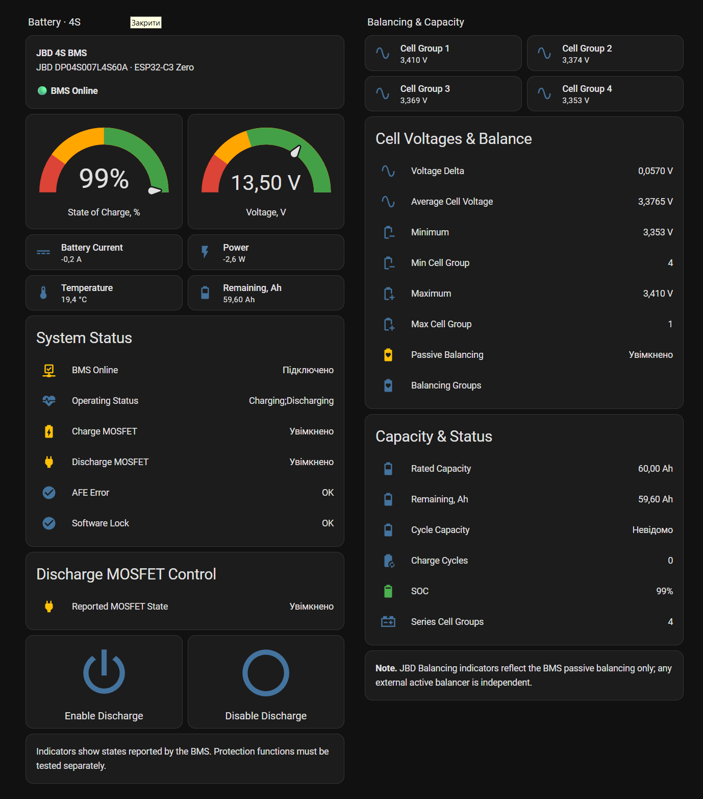
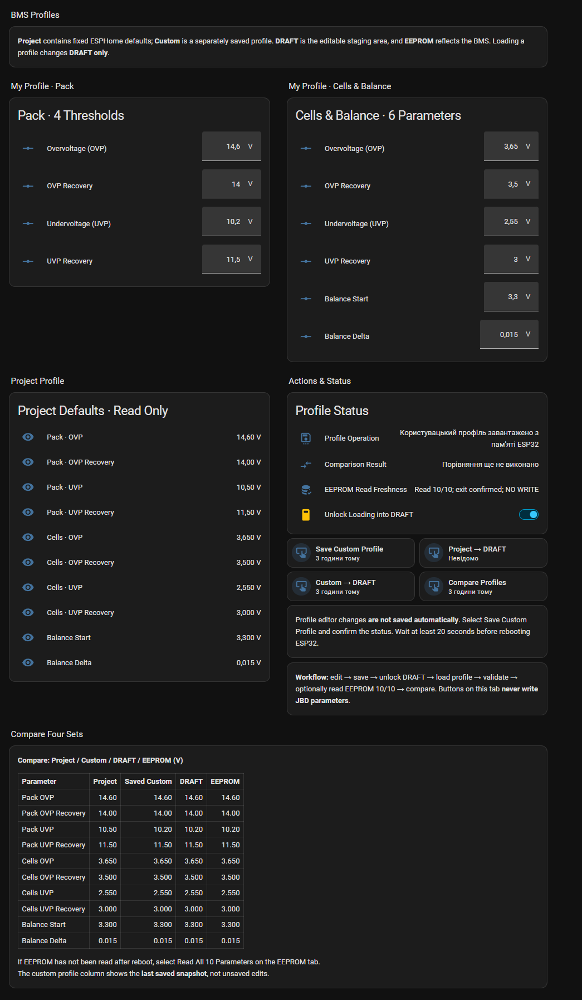
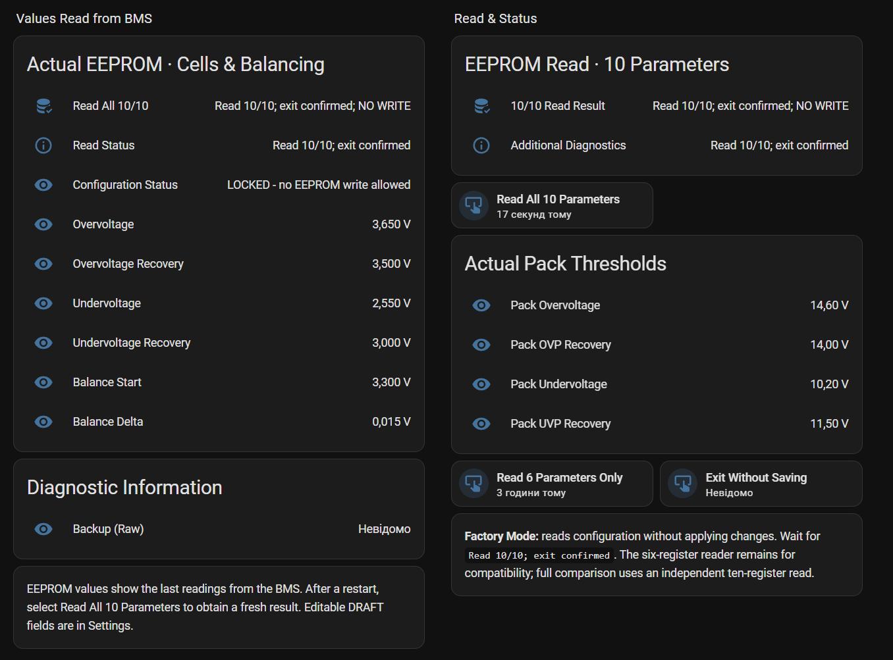
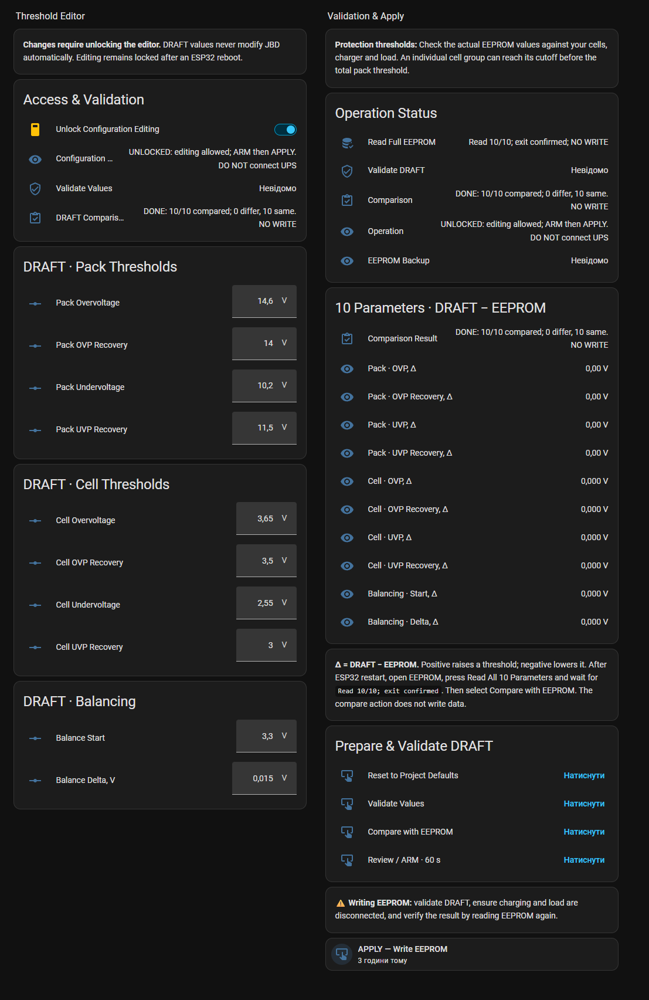
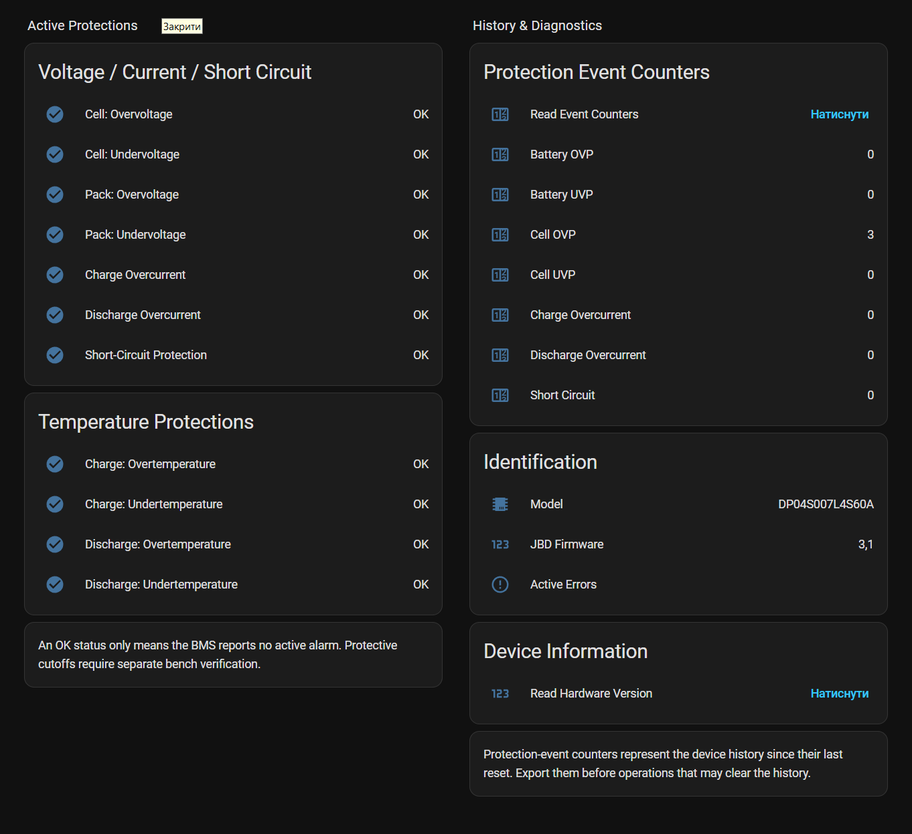
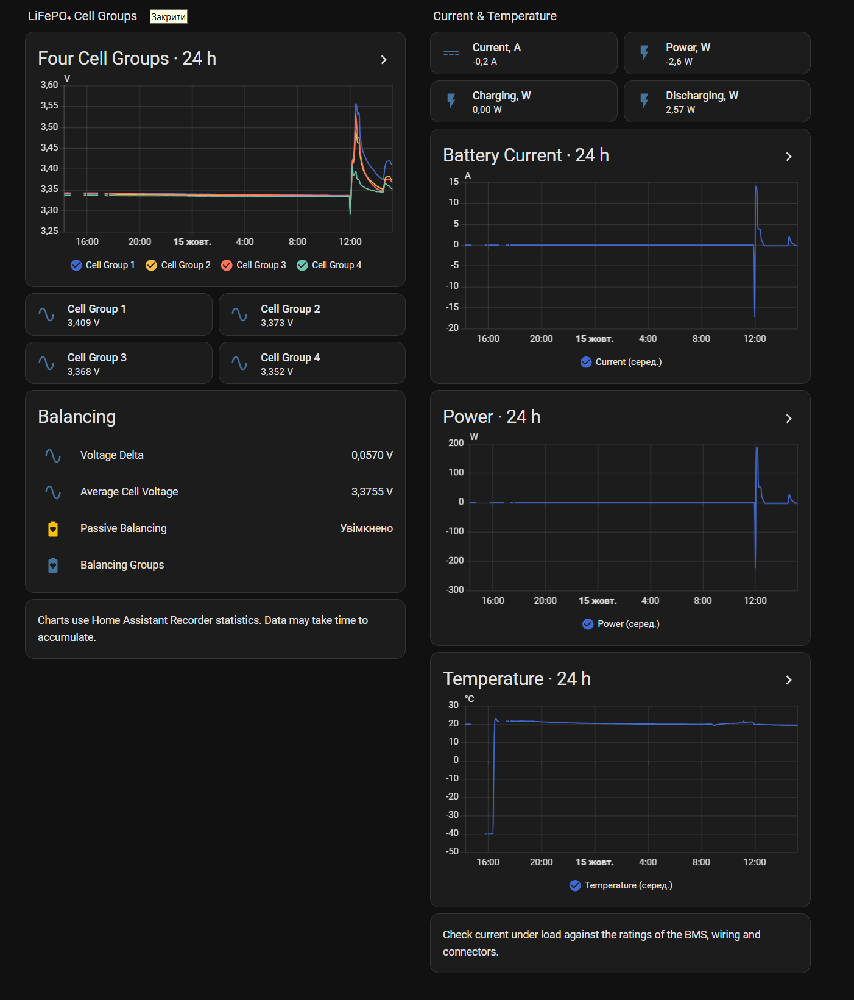
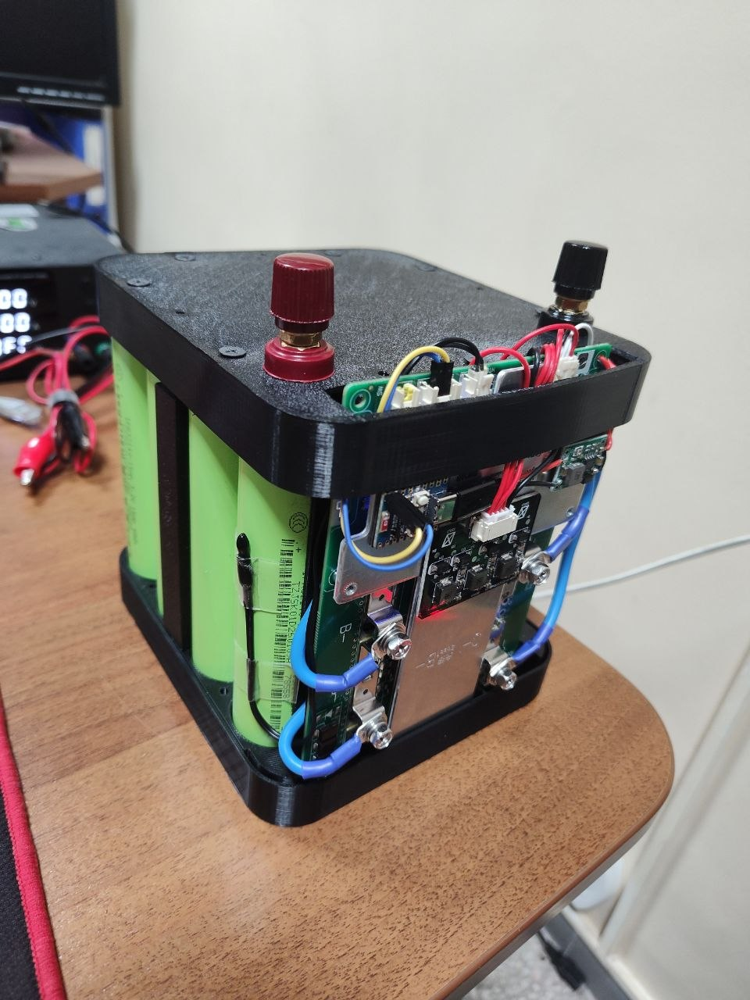
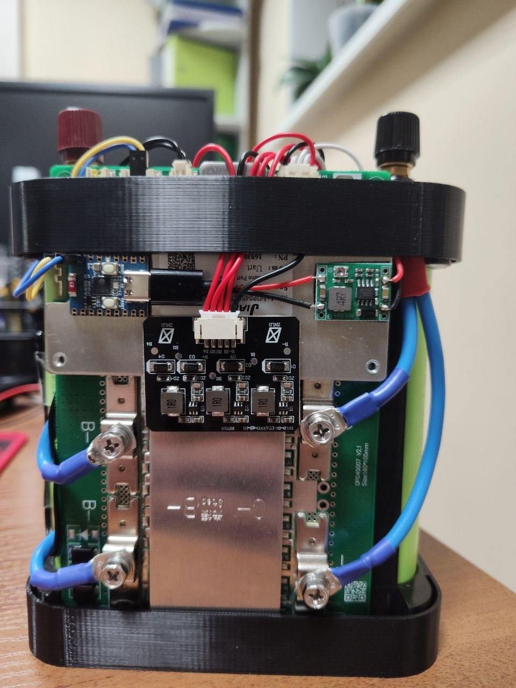

# JBD BMS ESPHome Configurator

**Моніторинг і конфігурування JBD Smart BMS через ESPHome та Home Assistant.** Доступні українська й англійська панелі.

[English README](README.md) · [Встановлення](docs/INSTALL_UA.md) · [Обладнання](docs/HARDWARE.md) · [Налаштування](docs/CONFIGURATION.md)

## Скриншоти

| Редактор профілів | Читання EEPROM |
|:--:|:--:|
|  |  |

Інші екрани: налаштування, захист, графіки

<table>
  <thead>
    <tr>
      <th align="center">Налаштування</th>
      <th align="center">Захист</th>
      <th align="center">Графіки</th>
    </tr>
  </thead>
  <tbody>
    <tr>
      <td align="center"></td>
      <td align="center"></td>
      <td align="center"></td>
    </tr>
  </tbody>
</table>

## Можливості

- Напруга батареї та груп, струм, потужність, SOC, ємність, температура й статуси захистів.
- Керування розрядним MOSFET і контроль його стану.
- Незалежне читання **10 регістрів EEPROM** без запису, порівняння EEPROM із DRAFT.
- Контрольований запис EEPROM: перевірка DRAFT, підтвердження ARM, резервне читання, APPLY та повторна перевірка.
- Проєктний і користувацький профілі; завантаження профілю змінює лише DRAFT.
- Дві панелі Home Assistant (EN/UA) по шість вкладок без додаткових Lovelace-компонентів.

## Сумісність

Перевірено автором на **JBD DP04S007-L4S 60A (4S, PCB V2.1)** та **ESP32-C3 Zero**, включно із записом APPLY та зчитуванням назад. Сумісність з іншими версіями JBD не підтверджена. **Бета-версія**; межі тестування наведені в [TESTING.md](docs/TESTING.md).

У тестовій конфігурації ESP32 живиться від акумуляторних клем **B+/B− через DC-DC 5 В**, додатково використовується зовнішній активний балансир **ZNLD**. Деталі — в [HARDWARE.md](docs/HARDWARE.md).

## Апаратна реалізація

Тестова **LiFePO₄ збірка 4S4P** використовує JBD BMS, ESP32-C3 Zero із живленням **5 В через DC-DC понижувач від B+ / B− акумулятора** та незалежний активний балансир ZNLD. Компоненти встановлені в корпусі, виготовленому на 3D-принтері. Схема підключення описана в [Hardware and wiring](docs/HARDWARE.md).

| Акумулятор у зборі | BMS, контролер і з'єднання |
|:--:|:--:|
|  |  |

## Встановлення

1. Перевір сумісність, електричні рівні й [розпіновку UART](docs/HARDWARE.md). Приклад: ESP32 GPIO4 (TX) → JBD RX; GPIO5 (RX) ← JBD TX; **9600 8N1**.
2. Обери прошивку [`jbd-bms-ua.yaml`](firmware/jbd-bms-ua.yaml) або [`jbd-bms-en.yaml`](firmware/jbd-bms-en.yaml). Різниця лише в мові службових повідомлень профілів, не в алгоритмах чи ID сутностей.
3. Створи локальний `secrets.yaml` за [`secrets.yaml.example`](secrets.yaml.example). **Не публікуй реальні паролі та ключі.**
4. Перевір і встанови YAML через ESPHome Device Builder.
5. Імпортуй [`українську`](dashboards/jbd-dashboard-uk.yaml) або [`англійську`](dashboards/jbd-dashboard-en.yaml) панель у **редактор повної YAML-конфігурації Dashboard** Home Assistant.
6. Перевір телеметрію та зчитай усі 10 параметрів EEPROM перед порівнянням із DRAFT.

Детальна [інструкція українською](docs/INSTALL_UA.md).

## Профілі та EEPROM

**Проєктний профіль, користувацький профіль, DRAFT та EEPROM** — окремі набори. Редагування профілів не записує BMS; для запису призначена окрема операція APPLY. Проєктні пороги — **приклад для конкретної 4S збірки**, а не універсальні безпечні налаштування. Таблиця регістрів і пояснення — [CONFIGURATION.md](docs/CONFIGURATION.md).

У конфігурації використано `logger.level: WARN`, інтервал опитування `5s` і тайм-аут `300ms`. Для тестового обладнання ці параметри дали стабільніший обмін UART.

## Подякувати автору

Якщо проєкт став вам у пригоді й хочеться просто подякувати автору, добровільні реквізити наведені в [THANKS.md](THANKS.md). Проєкт залишається безкоштовним і відкритим.

## Ліцензія й авторство

Оригінальні матеріали проєкту доступні за [MIT](LICENSE). Використовується зовнішній компонент [syssi/esphome-jbd-bms](https://github.com/syssi/esphome-jbd-bms) (Apache-2.0), без включення його вихідного коду. Для відтворюваних збірок після тестування слід зафіксувати перевірений commit зовнішнього компонента замість `@main`.

Повідомлення про помилки та Pull Requests вітаються: [CONTRIBUTING.md](CONTRIBUTING.md).
